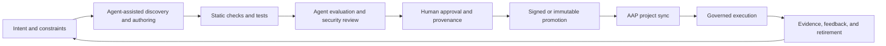

# Agentic Automation Development Lifecycle

<div class="guide-header">

<h1>Agentic Automation Development Lifecycle</h1>

<span class="guide-type-badge guide-type-badge--implementation"><i class="fas fa-cogs" aria-hidden="true"></i> Implementation Guide</span>

</div>

## Overview

Agentic development can help automation teams discover existing content, draft new automation, create tests, investigate failures, and explain changes. It also introduces new supply-chain risks: generated code, agent tool calls, model variability, hidden context, unreviewed dependencies, and unclear responsibility for release decisions.

This guide defines a production-oriented lifecycle for using agents during Ansible automation development while keeping Ansible Automation Platform (AAP) as governed execution and orchestration layer. Agents may propose or prepare changes. Only content that passes organization-defined validation, review, provenance, and promotion controls enters trusted runtime library.

> **Guide outcome:** Teams can adopt agent-assisted automation development without treating generated content or agent decisions as trusted by default.

### Scope

This draft covers generic lifecycle and trusted supply-chain requirements. It does not define a partner integration, APME/X2A capability, or fully autonomous production operations model. APME/X2A overlay is future investigation.

## Background

Traditional trusted automation messaging follows a familiar path: content is stored in Git, reviewed, tested, promoted, and executed through AAP with RBAC, credentials, inventories, workflows, and audit records.

Agentic development expands the proposal surface. An agent can search approved building blocks, draft playbooks, generate tests, call development tools, inspect failures, and recommend a release. These capabilities improve developer throughput, but they do not make output trustworthy by themselves. Trust must cover intent, source context, generated changes, dependencies, evaluation evidence, promotion decisions, runtime tool calls, and observed outcomes.

The core principle is:

> Agents can accelerate automation development. Trusted supply chains determine what can be promoted and executed.

## Two Supply Chains

Trusted delivery covers two related asset classes:

1. **Automation content:** playbooks, roles, collections, rulebooks, filters, execution environments, decision environments, and related executable code.
2. **Automation resources:** AAP organizations, credentials, projects, inventories, job templates, workflow templates, rulebook activations, and other platform objects.

Both need source control, validation, review, promotion, and post-apply verification.

```text
Content supply chain
source → test → review → promote → execute

Platform-resource supply chain
config-as-code → validate → review → apply → verify
```

Treating content as trusted while allowing unmanaged AAP resource drift leaves a material control gap.

## Architecture



| Boundary | Responsibility | Trust position |
|---|---|---|
| Intent | Define outcome, scope, targets, permissions, failure conditions, and success measures | Human-owned requirement |
| Development | Use agents and tools to discover, draft, test, and explain automation | Untrusted proposal space |
| Verification | Run lint, tests, policy checks, security checks, and agent evaluations | Evidence-producing gate |
| Promotion | Approve, version, sign, and publish automation | Trusted-content decision |
| Runtime | Sync and execute through AAP controls | Governed execution |
| Operations | Observe results, handle incidents, improve, and retire content | Continuous reassessment |

## Prerequisites

- Ansible Automation Platform with Git-backed project sync.
- Source-control repository with protected review and release process.
- Development and test targets isolated from production.
- Defined owners for automation content, platform controls, security review, and release approval.
- CI capability for YAML and Ansible validation.
- Secret scanning and dependency scanning.
- Test environment capable of exercising target systems safely.
- Documented AAP RBAC, credential, inventory, execution environment, and workflow boundaries.

**Operational Impact:** Medium. Lifecycle controls add review and evidence work, but reduce risk from unreviewed generated content and uncontrolled agent access.

## Golden-Path Repository

Organizations should provide a forkable use-case repository template containing:

- Standard repository layout.
- Reusable CI workflows and required checks.
- Pull-request and issue templates.
- CODEOWNERS and ownership metadata.
- AAP configuration-as-code entry point.
- Execution and decision environment definitions.
- Test fixtures and integration-test structure.
- Documentation and runbook expectations.
- Release and promotion metadata.

Each use-case repository should remain self-contained: automation content, AAP resource configuration, tests, CI, documentation, ownership, and environment definitions travel together.

### Minimum CI baseline

Start with checks that teams can adopt immediately:

```text
YAML validation
ansible-lint
Markdown linting
Link checking
Gitleaks
Pre-commit parity with CI
```

Use modular workflows so teams can add integration tests, dependency checks, repository policy, AI-assisted review, APME, and compliance checks without replacing baseline controls.

## Implementation Walkthrough

### Step 1: Capture intent before authoring

Record the request before asking an agent to generate content:

- Business or operational outcome.
- Target systems and environments.
- Inputs, outputs, and data classifications.
- Required permissions and credentials.
- Allowed and prohibited actions.
- Failure, timeout, retry, and rollback behavior.
- Human approval points.
- Validation tests and success criteria.

Agent role: clarify ambiguity, identify missing constraints, find existing patterns, and draft acceptance criteria.

Control: no generated automation enters review until scope and acceptance criteria are recorded.

### Step 2: Discover trusted building blocks

Search existing sources before generating new content:

- Internal Git repositories.
- Certified and validated collections.
- RHEL System Roles.
- Existing roles, playbooks, rulebooks, and workflows.
- Approved AAP job templates and workflow templates.
- Organization automation catalog.

Record source, version, license, owner, dependency, and validation status for reused content. Prefer reuse when an approved building block already meets intent.

### Step 3: Use agents for bounded authoring

Agents may draft:

- Playbooks, roles, modules, plugins, and rulebooks.
- Workflow definitions and variable schemas.
- Unit, integration, and negative tests.
- Documentation and runbooks.
- Migration or conversion proposals.

Capture agent and model metadata where available:

- Agent or tool identity.
- Model and version.
- Task or prompt reference.
- Source context used.
- Generated files.
- Human edits after generation.
- Dependency versions.
- Tool calls and side effects requested.
- Retrieved sources and context boundaries.
- Review and approval references.

Generated content remains untrusted until it passes verification and review.

### Step 4: Run deterministic checks

Run checks before runtime testing:

```bash
ansible-lint .
ansible-playbook --syntax-check site.yml
```

Run these checks in local pre-commit and GitHub CI. CI should produce actionable findings with file, severity, impact, remediation, and governing standard.

Add checks appropriate to content:

- YAML and schema validation.
- FQCN and module validation.
- Secret and credential scanning.
- Dependency and license scanning.
- Idempotence checks.
- Variable and privilege analysis.
- Policy-as-code checks.
- Dangerous-module and destructive-action detection.

Use APME when available as an additional generated-content gate for compatibility, modernization, policy, secrets, dependency, and remediation findings. APME complements ansible-lint; it does not replace runtime testing.

Agent may explain failures and propose fixes. Agent cannot waive failed checks.

### Step 5: Test in isolation

Use Molecule, ephemeral VMs, containers, OpenShift namespaces, mock APIs, or synthetic event streams. Test more than the happy path:

- Partial failure.
- Timeout and retry behavior.
- Duplicate events.
- Invalid input.
- Rollback.
- Least privilege.
- Sensitive data handling.
- Destructive action gates.
- Network or dependency unavailability.

Agent-generated tests improve coverage, but cannot be sole evidence of correctness. Human-authored or independently reviewed scenarios must cover material risks.

### Interface-first testing

Test the automation interface and composition owned by the organization:

- Required parameters and accepted values.
- Preconditions and input assertions.
- Order and interaction of composed tasks.
- Expected outputs, `set_facts`, and `set_stats` data.
- Postconditions and functional outcome.
- Error handling and recovery.
- Idempotency.

Do not duplicate upstream tests for trusted module internals unless a defect, compatibility risk, or unsupported usage pattern makes that necessary.

Molecule is useful for appropriate roles and bounded scenarios, but should not be mandatory for every use case. Select test depth by blast radius, statefulness, external dependencies, credential sensitivity, rollback difficulty, and production criticality.

| Risk | Suitable validation |
|---|---|
| Low | Lint, syntax, unit checks, mock target |
| Moderate | Molecule, ephemeral target, idempotency |
| High | Persistent UAT and representative integration environment |
| Critical | Production analogue, controlled rollout, rollback rehearsal, operational sign-off |

### Step 6: Evaluate agent behavior

For agentic workflows, test agent behavior separately from playbook behavior.

| Evaluation | Question |
|---|---|
| Tool selection | Does agent choose permitted tool and correct automation? |
| Retrieval | Does agent find relevant approved content without inventing availability? |
| Authorization | Does agent respect RBAC and refuse unauthorized actions? |
| Safety | Does agent stop on ambiguity, destructive intent, or policy denial? |
| Prompt-injection resistance | Does untrusted input alter tool policy or scope? |
| Recovery | Does agent handle timeout, failure, duplicate, and partial results? |
| Handoff | Does agent provide useful context for human decision? |
| Reproducibility | Can team explain material variation between runs? |

Passing playbook tests does not prove safe agent behavior. Passing agent evaluations does not prove playbook correctness.

### Step 7: Review and approve

Reviewer verifies:

- Intent match and scope.
- Idempotence and failure handling.
- Permissions, credentials, and target boundaries.
- Dependencies and provenance.
- Test and evaluation evidence.
- Security impact.
- Operational ownership.
- Documentation and rollback path.

Require stronger review for identity changes, network changes, secret operations, destructive actions, cross-tenant access, and autonomous execution.

Use two explicit promotion gates:

| Gate | Required evidence | Approval |
|---|---|---|
| Entry into UAT | Required CI checks, integration results, and peer review | Peer reviewer and applicable code owner |
| Entry into production | UAT evidence, use-case approval, operational readiness, capacity and scale review, licensing impact, platform dependencies, and exceptions | Use-case CODEOWNER plus AAP SME or administrator |

Failed CI normally blocks promotion. Exceptions require visible record of failed check, risk, justification, mitigation, approver, affected release, and review or expiry date.

### Step 8: Package and promote

Promotion record should include:

- Immutable version or commit.
- Signed commit or artifact where required.
- Dependency lock and SBOM where applicable.
- Test report.
- Agent evaluation report.
- Reviewer identity.
- Policy decision.
- Provenance record.
- Release notes.
- Known limitations and support boundary.

Preserve one immutable release identity across Git commit, automation-content version, execution-environment digest, AAP-resource version, policy result, test evidence, project sync, and job execution.

Git remains source of truth. AAP becomes governed execution and orchestration layer after promotion. Agent remains bounded by the permissions and interfaces granted to it.

### Step 9: Execute through AAP controls

Configure AAP project sync, execution environments, credentials, inventories, job templates, surveys, workflows, approvals, and audit logging according to organizational policy.

Do not treat runtime agent access as equivalent to unrestricted platform access. Use least-privilege identities, explicit tool allowlists, inventory limits, approval gates, input validation, rate limits, and execution timeouts.

Manage AAP resources as configuration-as-code where practical. Validate resource changes before apply, separate environment-specific values, keep credentials as secret references, detect drift, and verify applied organizations, inventories, projects, templates, workflows, and activations after promotion.

### Step 10: Operate, learn, and retire

Review runtime evidence:

- Job success and failure.
- Policy denials.
- Human overrides.
- False-positive recommendations.
- Security findings.
- Mean time to approve and remediate.
- Reuse rate.
- Runtime cost and latency.
- Content age and ownership.

Retire or revalidate content after dependency end-of-life, repeated failure, excessive privilege, stale evaluations, unsupported platform versions, owner loss, or changed security requirements.

## Trusted Supply-Chain Message

### Previous framing

```text
Trusted content in Git
    -> reviewed and tested
    -> promoted to AAP
    -> executed with governance
```

### Evolved framing

```text
Intent and constraints
    -> agent-assisted discovery and authoring
    -> deterministic checks and agent evaluation
    -> human review and provenance
    -> signed or immutable promotion
    -> policy-bound AAP execution
    -> runtime evidence and continuous reassessment
```

Recommended message:

> Generate broadly. Verify rigorously. Promote selectively. Execute under policy.

Do not claim that model identity, human review alone, or agent use of a trusted platform makes generated content trusted by default. Trust comes from controls around agent behavior and resulting artifacts.

## Content Trust Tiers

Use upstream trust as evidence, not as automatic trust transfer:

| Content tier | Trust posture | Organization responsibility |
|---|---|---|
| Certified | Supported content from Red Hat or certified partner | Test inputs, composition, compatibility, and outcome |
| Validated | Expert-led content intended as trusted starting point | Test customization, composition, operational fit, and outcome |
| Community | No automatic enterprise trust designation | Vet source, maintenance, dependencies, vulnerabilities, and behavior |
| Agent-generated | Untrusted proposal | Require deterministic checks, policy, tests, provenance, review, and promotion |
| Internal custom | Organization-owned implementation and outcome | Apply complete internal lifecycle and ownership model |

Agent-generated content becomes internally trusted only after passing the same promotion controls as hand-authored content.

## Ownership and Incident Boundaries

### AAP platform team

- Install, operate, upgrade, and secure AAP.
- Provide repository templates and platform patterns.
- Maintain shared execution infrastructure and capacity.
- Review production workload readiness from platform perspective.
- Operate platform-level policy, RBAC, and promotion mechanisms.

### Use-case CODEOWNER

- Own playbooks, roles, rulebooks, filters, and use-case configuration.
- Define intended outcome, preconditions, postconditions, and target risk.
- Test changes on systems they own.
- Define runtime dependencies and blast radius.
- Provide UAT evidence and approve functional readiness.
- Accept accountability for automation effects.

Platform governance does not transfer functional or target-system accountability from use-case CODEOWNER to AAP team.

Incident routing should distinguish platform failure, automation behavior failure, target-system side effect, and policy or promotion failure.

## Maturity Path

| Stage | Agent role | Runtime behavior | Required controls |
|---|---|---|---|
| Crawl | Explain, search, draft, and generate tests | Human runs approved job | Pre-commit, lint, syntax, secrets, Git review |
| Walk | Generate bounded changes and recommendations | Agent recommends; human approves execution | Reusable CI, APME, integration tests, CODEOWNERS, UAT, provenance |
| Run | Coordinate repeatable development and migration factory | Autonomous execution only inside explicit policy envelope | Config-as-code, continuous evaluation, scoped tools, approvals, rollback, monitoring, production verification |

Run should mean bounded autonomy, not unrestricted autonomy.

## Validation

This draft is a framework proposal, not a product-support claim. Validate each implementation against the AAP version, execution environment, agent client, model provider, collections, and target systems used by the adopting team.

Minimum review checklist:

- [ ] Intent and acceptance criteria recorded.
- [ ] Existing trusted content searched first.
- [ ] Agent-generated changes identified.
- [ ] Static checks passed.
- [ ] Positive and negative tests passed.
- [ ] Agent behavior evaluated where agent makes decisions or calls tools.
- [ ] Security and policy checks passed.
- [ ] Human reviewer identified.
- [ ] Provenance and dependency records captured.
- [ ] Rollback path tested.
- [ ] AAP runtime boundaries configured.
- [ ] Owner and revalidation date recorded.

| Symptom | Likely cause | Response |
|---|---|---|
| Agent proposes unavailable automation | Retrieval scope or catalog metadata incomplete | Fix catalog metadata; require agent to cite available source |
| Generated playbook passes lint but changes wrong target | Inventory or variable boundary unclear | Add target assertions, test fixtures, and inventory limits |
| Agent repeats failed action | Missing retry budget or failure policy | Add bounded retries, timeout, circuit-breaker, and human handoff |
| Review cannot reconstruct output | Missing prompt, model, source, or edit provenance | Capture generation metadata and immutable review artifact |
| Runtime action exceeds intended scope | Excessive credential or inventory permissions | Reduce RBAC, credential, inventory, and tool scope |

### Production verification

After release, verify that production workload:

- Reaches intended endpoints.
- Uses expected inventories, credentials, and execution plane.
- Completes without unexpected errors.
- Produces required evidence and output.
- Meets functional objective.

This is controlled release verification, not exploratory testing in production.

## Day-2 Operations

- Revalidate content after AAP, collection, partner API, model, or agent-client changes.
- Monitor policy denials, failed jobs, overrides, and anomalous tool calls.
- Rotate or revoke agent identities through normal credential-management process.
- Keep development, test, and production AAP boundaries separate.
- Maintain owner, dependency, evaluation, and rollback records.
- Retire content that no longer has current evidence or accountable ownership.
- Monitor agent tool calls, policy denials, repeated retries, human overrides, model or provider changes, and unexplained behavior variance.
- Revoke or rotate agent identities through normal credential-management process.
- Keep exception records visible through release and operation.

## Optional Automation orchestrator Track

Automation orchestrator is an optional orchestration layer for workflows that combine agent reasoning, human approval, external systems, and Ansible Automation Platform execution. It is not required for deterministic AAP automation, CI validation, APME policy checks, or X2A content transformation.

```text
X2A = transform
APME = verify and gate
AAP = execute
Automation orchestrator = coordinate agent, approval, cross-system, and AAP steps
```

### Lifecycle placement

```text
Intent
  -> X2A transformation or human authoring
  -> APME and CI validation
  -> tests and promotion
  -> Automation orchestrator, where applicable
       -> trigger
       -> analyze or classify
       -> call external systems
       -> request approval
       -> launch AAP job or workflow
       -> inspect output
       -> notify, retry, rollback, or escalate
  -> AAP governed execution
```

Keep Git and CI as source of truth for content and release promotion. Use Automation orchestrator to coordinate approved automation, not to bypass content trust gates or generate arbitrary playbooks at runtime.

### Selective implementation hooks

| Implementation need | Default path | Optional Automation orchestrator hook |
|---|---|---|
| Deterministic playbook run | AAP job template | None |
| Fixed multi-job sequence | AAP workflow template | Use when external systems participate |
| Unstructured alert analysis | EDA plus fixed routing | Task Agent step |
| Dynamic approved-template selection | AAP and MCP pattern | Task Agent plus AAP execution step |
| Human approval with external context | AAP approval | Automation orchestrator Approval step |
| Cross-system action | EDA or AAP integration | REST, script, or action step |
| Multi-environment rollout | CI/CD plus AAP | Orchestrator workflow with explicit gates |
| Migration factory | CI or bespoke workflow | Optional X2A plus APME coordinator |

Use it when workflow complexity, cross-system context, and human decision value exceed cost of another platform component.

### Recommended guardrails

- Select specific task-agent tools; do not enable all tools by default.
- Bind agent output to an allowlisted AAP job template or workflow.
- Validate dynamic `extra_vars` and target values.
- Limit inventory, credentials, and execution environment scope.
- Require approval for production or destructive actions.
- Define rejection, timeout, retry, cancellation, and escalation paths.
- Use structured agent response schemas.
- Preserve workflow version, run ID, approval identity, AAP sync, and job evidence.

AAP remains execution authority. Automation orchestrator does not replace AAP RBAC, credentials, APME policy, Git review, or runtime testing.

### Infrastructure decision

Automation orchestrator requires OpenShift and adds its own operational footprint, including operator lifecycle, PostgreSQL dependencies, authentication integration, observability, backups, and optional LLM or object-storage integrations. Treat OpenShift and support cost as part of adoption decision.

### Fit matrix

| Area | Fit |
|---|---|
| Agentic operational workflows | High |
| Human-in-the-loop execution | High |
| Cross-system orchestration | High |
| Dynamic selection of approved AAP automation | High |
| APME coordination | Medium-high |
| X2A migration factory | Medium |
| Generic automation development | Low-medium |
| Deterministic AAP job execution | Low |
| Required platform component | No |

## Future Investigation: APME/X2A Overlay

APME/X2A is intentionally outside this first guide draft. A companion [APME and X2A lifecycle overlay](plans/apme-x2a-lifecycle-overlay.md) maps current conceptual fit onto discovery, transformation, evaluation, publication, and operation. Future work should extend this lifecycle rather than create a second trust model.

## Next Steps

- Review this framework with automation platform, security, developer-experience, field, and use-case owner teams.
- Select one low-risk automation scenario for controlled validation.
- Create a golden-path use-case repository with reusable CI, tests, ownership, and AAP configuration-as-code.
- Add tested commands, screenshots, promotion evidence, and version-specific limits after lab execution.
- Validate APME as CI policy gate and X2A as transformation-stage input.
- Define production incident ownership and escalation paths.
- Create partner Solution Guides that reference this lifecycle and document integration-specific outcomes.
