# APME and X2A Lifecycle Overlay

## Purpose

Map APME and X2A onto the proposed [Agentic Automation Development Lifecycle](../README-Agentic-Automation-Development-Lifecycle.md). This is a design note for later guide revision, not a product-support claim.

## Short assessment

Fit is strong because products occupy different lifecycle positions:

- **X2A** accelerates discovery, migration planning, transformation, and initial Ansible authoring.
- **APME** supplies compatibility, modernization, policy, security, dependency, and remediation checks for generated Ansible.
- **AAP** remains governed execution and orchestration layer after promotion.

Recommended relationship:

```text
X2A creates migration candidates.
APME proves content quality and policy posture.
AAP runs promoted automation under governance.
```

Do not treat X2A output as trusted merely because X2A validated it. Do not treat an APME-clean scan as proof that automation will achieve its intended runtime outcome.

## Overlay on lifecycle

```mermaid
flowchart LR
    I[Intent and constraints]
    X1[X2A<br/>Discover source estate]
    X2[X2A<br/>Create migration plan]
    X3[X2A<br/>Analyze module]
    X4[X2A<br/>Generate Ansible]
    A1[APME<br/>Scan generated content]
    A2[APME<br/>Policy, security, compatibility,<br/>modernization, dependency checks]
    A3[APME<br/>Deterministic or reviewed remediation]
    T[ansible-lint, Molecule,<br/>integration and staging tests]
    H[Human review,<br/>provenance and approval]
    G[Git promotion]
    R[AAP project sync]
    E[AAP governed execution,
    evidence and operations]

    I --> X1 --> X2 --> X3 --> X4 --> A1 --> A2 --> A3 --> T --> H --> G --> R --> E
    E -. feedback and retirement .-> I
```



The overlay preserves main guide trust boundaries:

| Lifecycle stage | Primary capability | Trust position |
|---|---|---|
| Intent | Team defines outcome, scope, permissions, and acceptance criteria | Human-owned requirement |
| Discovery | X2A inspects legacy automation and dependencies | Untrusted analysis context |
| Planning | X2A creates migration plan and module-level conversion plan | Proposed plan |
| Transformation | X2A generates Ansible roles, tasks, templates, and supporting files | Untrusted generated content |
| Verification | APME scans and classifies findings across policy, modernization, security, and dependency domains | Evidence-producing gate |
| Remediation | APME applies deterministic fixes or produces reviewed remediation proposals | Controlled change candidate |
| Runtime testing | ansible-lint, Molecule, integration tests, staging, and AAP test jobs | Execution evidence |
| Promotion | Human review, provenance, protected Git branch, and release decision | Trusted-content decision |
| Operation | AAP executes with RBAC, credentials, inventories, workflows, approvals, and audit | Governed runtime |

## Product boundaries

### X2A owns

- Legacy source discovery.
- Migration planning.
- Source-to-output mapping.
- Conversion-agent workflow.
- Migration progress and module selection.
- Initial generated tests and documentation.
- Source-to-output traceability.

X2A is an **authoring and transformation accelerator**.

### APME owns

- Generated-content quality floor.
- AAP and ansible-core compatibility checks.
- Deprecated or removed module detection.
- Organization policy checks.
- Secret scanning.
- Dependency and collection health checks.
- Deterministic remediation.
- Scan evidence and promotion-gate input.

APME is a **verification and policy gate**.

### AAP owns

- Approved automation library.
- Execution environments.
- Credentials and RBAC.
- Inventory and target boundaries.
- Job templates and workflows.
- Approval gates.
- Runtime audit and operational evidence.

AAP is the **trusted execution layer**.

## Maturity overlay

| Maturity | X2A | APME | AAP |
|---|---|---|---|
| Crawl | Generate migration proposal | Scan and report | Human runs approved test job |
| Walk | Convert bounded modules | Gate pull request; apply safe fixes | Human approves runtime execution |
| Run | Coordinate repeatable migration factory | Mandatory policy, security, and evidence gate | Execute promoted content within explicit policy envelope |

Run means controlled migration at scale, not blind autonomous conversion.

## Fit and gaps

| Question | Assessment |
|---|---|
| Does X2A fit agent-assisted authoring? | Strong. X2A is purpose-built for source analysis, planning, and conversion. |
| Does APME fit generated-content verification? | Strong. APME covers static and semi-static analysis, policy, modernization, secrets, dependencies, and remediation. |
| Can APME prove runtime success? | No. Runtime state, inventory, variables, reachability, and external APIs still need execution-time tests. |
| Can X2A publish directly to AAP? | Capability exists in public X2A material, but direct publish should remain downstream of lifecycle gates. |
| Does this replace human review? | No. Human review remains required for scope, risk, permissions, evidence, and promotion. |
| Is product support proven by this overlay? | No. This note maps conceptual fit. Version-specific support requires controlled validation. |

## Required provenance chain

Future implementation guide should show one joined record across tools:

```text
Source repository and commit
  -> X2A version, model, agent, and migration plans
  -> generated files and conversion diff
  -> APME version, rules, findings, and remediation diff
  -> lint, test, and staging evidence
  -> reviewer and approval decision
  -> promoted Git commit
  -> AAP project sync and execution records
```

Without this chain, team cannot reliably answer what source became what automation, which agent changed it, which controls passed, and what AAP executed.

## Guardrails

1. X2A output enters lifecycle as proposed content.
2. APME scan is mandatory before promotion.
3. APME remediation must produce visible diff and fresh scan result.
4. Agent-generated tests cannot be sole correctness evidence.
5. APME-clean means no known findings under configured rules, not runtime success.
6. Direct X2A-to-AAP publish must not bypass Git review, policy, provenance, and runtime testing.
7. AAP credentials, inventory, and job permissions remain least-privilege and explicit.

## Recommended guide wording

> X2A accelerates discovery, planning, and transformation of existing automation into Ansible content. APME evaluates transformed content against compatibility, modernization, policy, security, and dependency controls. AAP executes only content promoted through the organization’s source-control and approval process.

Avoid:

> X2A creates production-ready Ansible automatically.

Use:

> X2A creates migration proposals and validated drafts that require organization-specific testing, review, and promotion controls.

## Later guide work

1. Validate one low-risk migration scenario end to end.
2. Add X2A migration-plan and output examples.
3. Add APME scan and remediation evidence.
4. Add Molecule or staging evidence showing runtime boundary.
5. Add AAP promotion and execution evidence.
6. Convert this overlay into a guide architecture diagram and companion Solution Guide pattern.

## Evidence status

- APME role: documented and source-observed from public repository and local project material.
- X2A role: documented and source-observed from public repository and plugin material.
- Combined lifecycle: inferred architecture; not yet validated as an integrated deployment.
- AAP promotion path: design recommendation; version-specific behavior requires controlled test.
